

  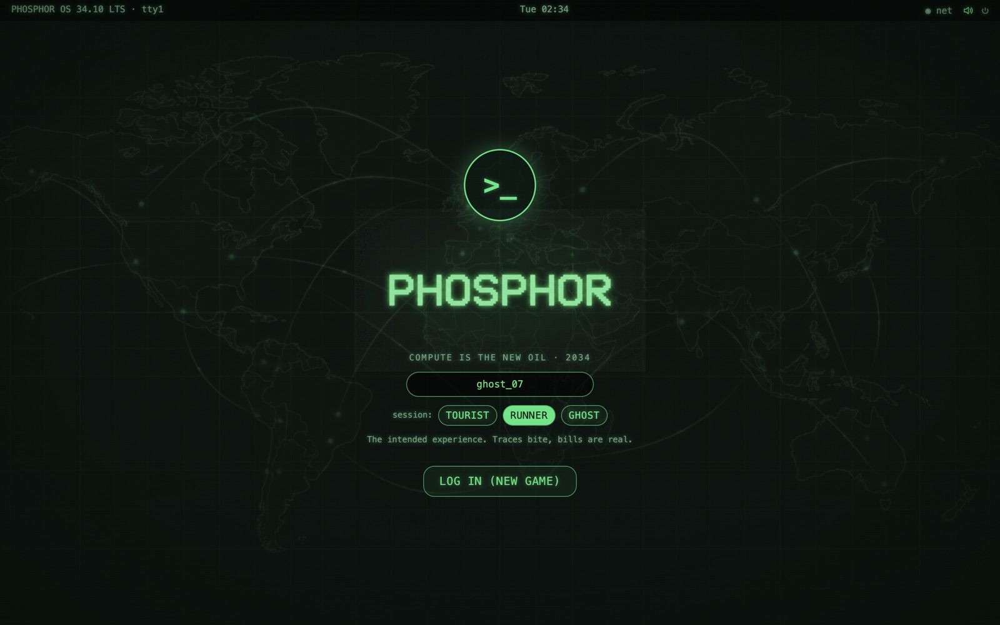

<h1 align="center">PHOSPHOR</h1>

<b>Compute is the new oil. 2034.</b> 
A green-phosphor hacking sim for Windows, macOS and Linux. A spiritual sequel to <i>Uplink</i>.

  <a href="https://github.com/BoKu/phosphor-releases/releases/latest"><b>Download the latest release</b></a>

---

The Meridian consortium rations the world's compute, and you are a freelance **runner** with a second-hand laptop and an AI assistant called **SPARROW**. Take contracts from the Hearth board, bounce through relays, crack servers layer by layer, wipe your logs and get out before the trace lands. Spend what you earn on a bigger rig, and decide what to do with the secrets you find.

## Features

- **Real-feeling intrusions.** Build a bounce chain across a world map, then break firewalls, passwords, IDS, 2FA and encryption in order while a live trace closes in.
- **GPU-accelerated cracking view.** WebGL shaders drive the CRT glow, scanlines and the cracking display.
- **A story worth following.** About 25 to 30 story contracts across three acts, with choices that change how it ends. Three endings in all.
- **LANTERN, a second campaign for puzzle solvers.** Fifteen chapters with their own servers, characters and ending. Each clue has to be broken into, stolen, decoded and pieced together, with a pencil and paper or the in-game Notepad and Paint apps.
- **A command-line Terminal.** Read files with `ls`, `cat`, `grep`, `decode` and `decrypt`, with built-in help for every command.
- **Rival crews and voicemail.** Top-tier contracts can be contested. Beat a rival crew to a job and they will leave you a voicemail, and if you were sloppy, they may make good on it.
- **Story progress at a glance.** A Story panel on your Gateway tracks every act and stays free of spoilers until you get there.
- **A whole desktop OS.** BIOS boot, login screen, taskbar with pinnable apps, start menu with search, mail with an archive, news ticker, file browser, Notepad and Paint.
- **Hardware to grow into.** Five rig tiers. Upgrade CPU, GPU, RAM, cooling and network, rent a vault, run scripts.
- **Heat and consequences.** Leaks, Squawk posts and sloppy logs raise your heat. Too much and your rig gets seized.
- **Three difficulties.** Tourist, Runner and Ghost. On Ghost, a seizure ends the run.
- **Illustrated throughout.** Portraits for everyone who mails you, a picture for every kind of target, shop renders, news photos and act title cards.
- **Original procedural music and sound.** No samples, all generated live.
- **Plain JSON saves** that you can back up or carry between computers.

## The story

The main story, *Quiet Hand*, runs across three acts. Each act opens with a title card. Story contracts appear on the Hearth board as your rating grows, and some of them end with a choice.

### Act I: The Inheritance

A runner called **Wren** vanished and left you everything: his rig, his place on the Hearth board, and SPARROW, the assistant he wrote. Nobody will say where he went. Then you find a contract he never finished.

### Act II: The Throttle

Overnight, Meridian rations the world's compute and calls it fair. Hospitals go dark. Strangers start writing to you, and each one wants something different from the runner who picked up Wren's trail. Somebody is getting rich from the shortage.

### Act III: KILN

Everything points to one name. Getting there will take your best rig, your nerve, and the truth about the people who brought you this far. When you arrive you will have to choose, and the choices you made along the way will count.

### LANTERN

Somewhere along the way, a stranger who signs as **LANTERN** starts sending you puzzles. Bring a pencil.

## Screenshots

| | |
|---|---|
| 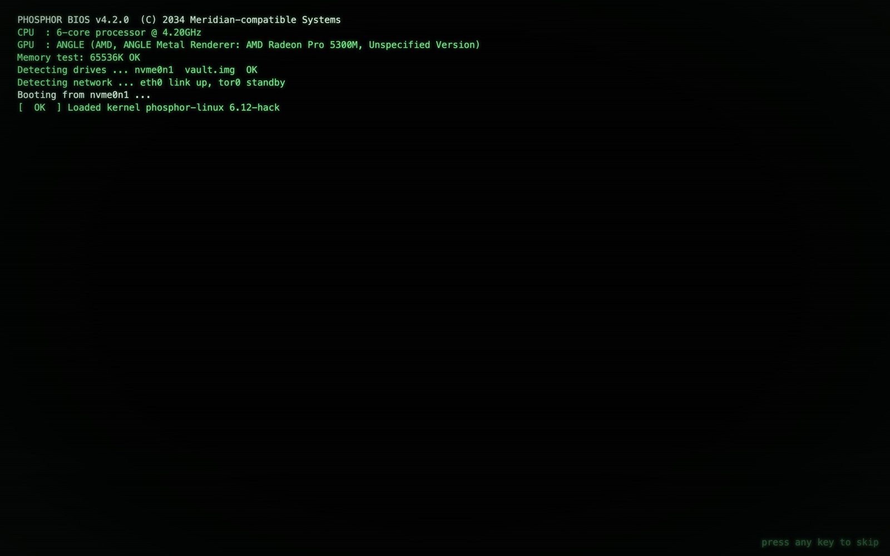 **BIOS boot** | 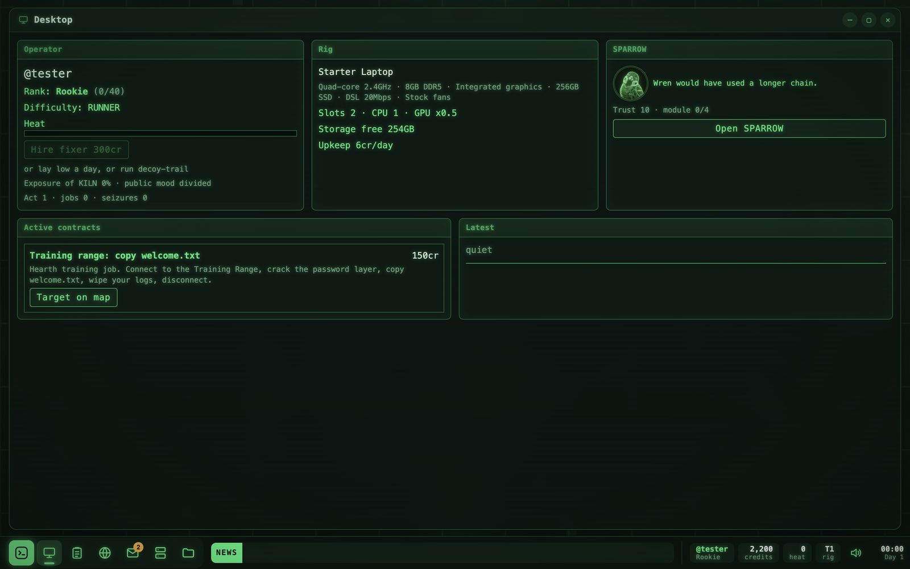 **Desktop** |
| 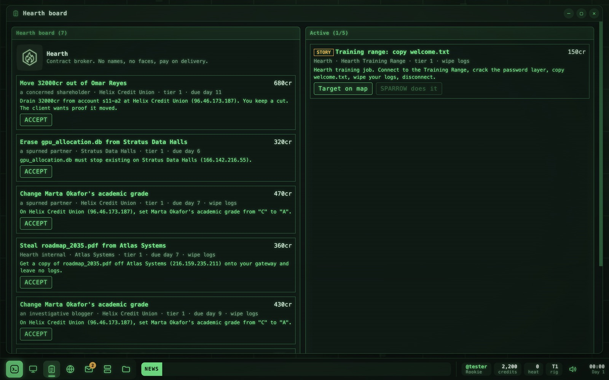 **Hearth board: contracts** | 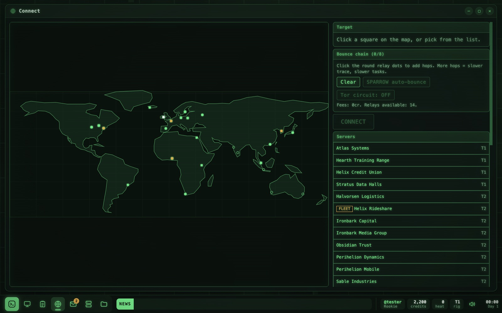 **Connect: plan your bounce chain** |
| 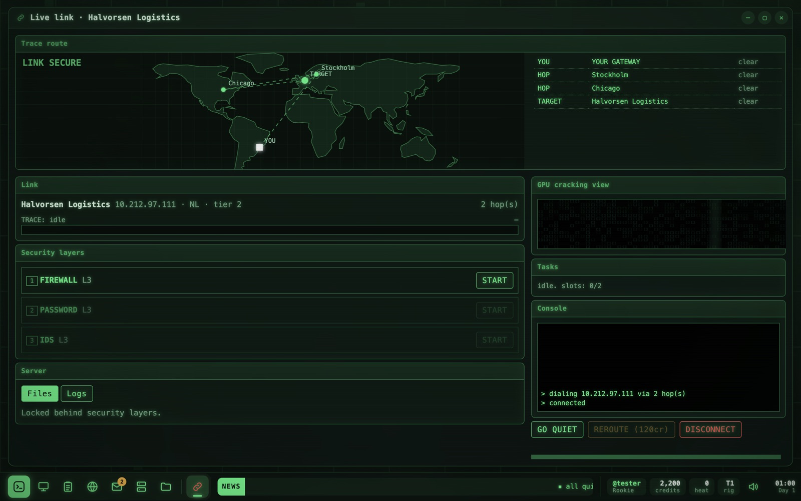 **Live link: crack the layers** | 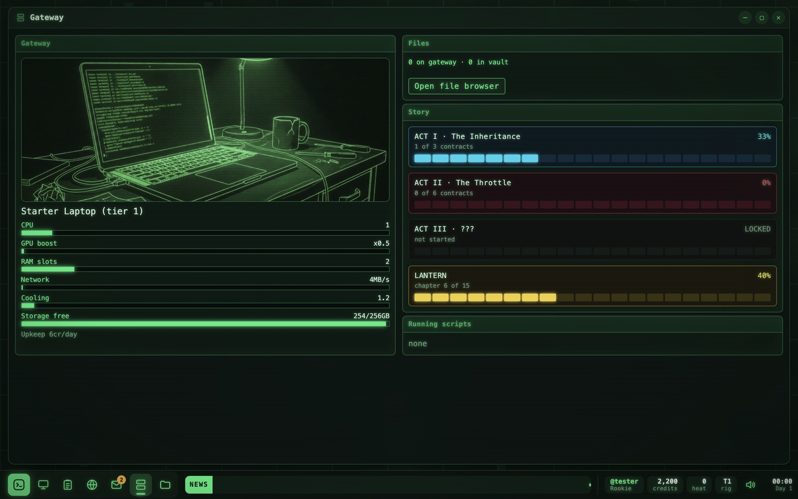 **Gateway: your rig and story progress** |
| 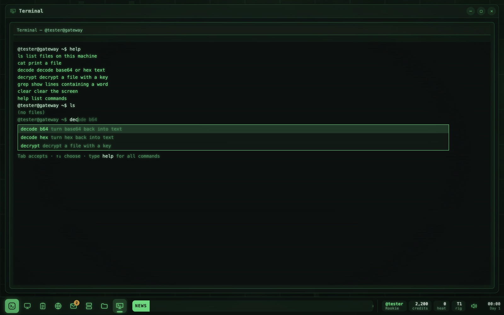 **Terminal, with help and autosuggest** | 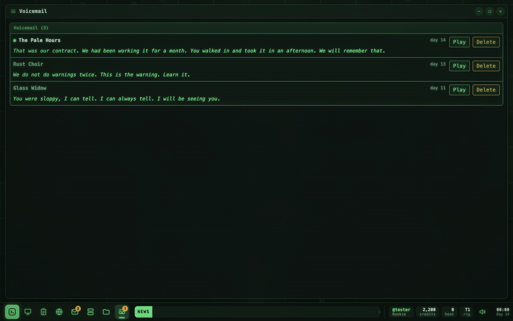 **Voicemail from rival crews** |
| 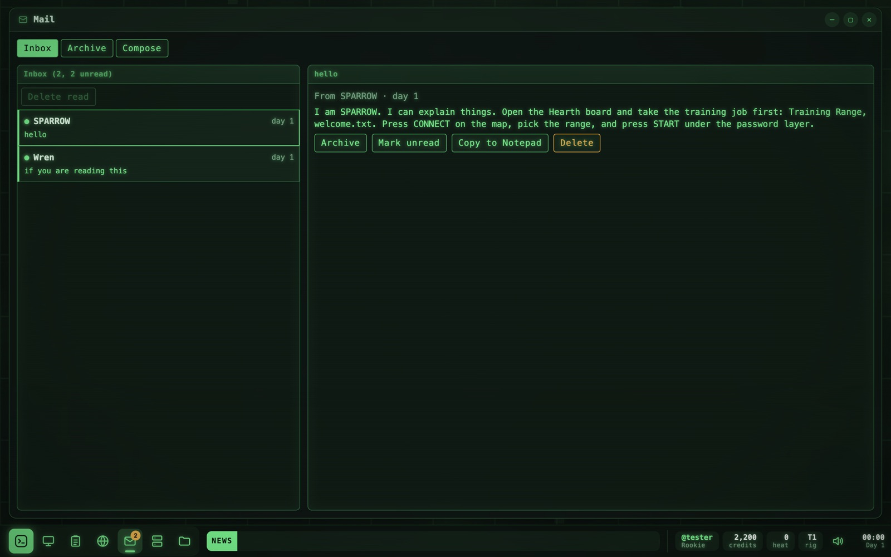 **Mail, with inbox and archive** | 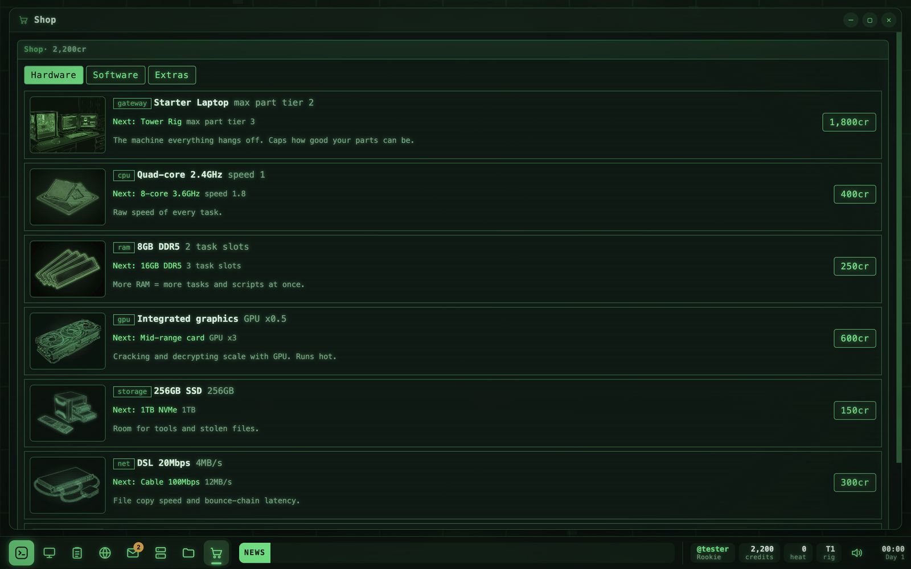 **Shop: upgrade your rig** |
| 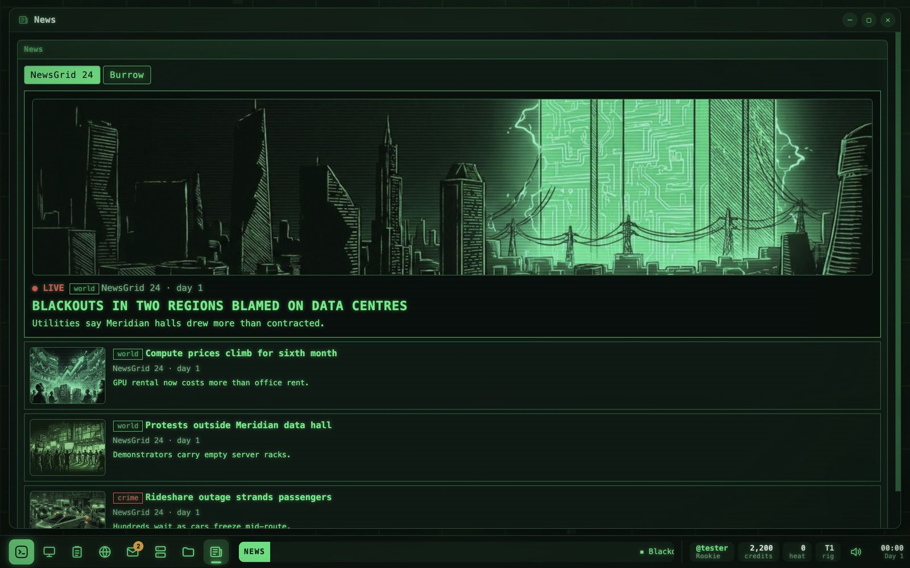 **NewsGrid: the world reacts** | 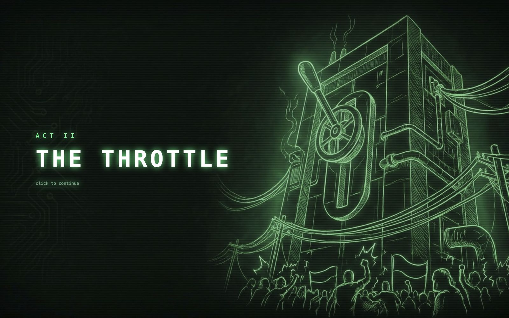 **Act II: The Throttle** |

## Download

Get the newest build from the **[Releases page](https://github.com/BoKu/phosphor-releases/releases/latest)**.

| System | File | Notes |
|---|---|---|
| Windows (installer) | `Phosphor Setup x.y.z.exe` | Installs and adds a Start menu shortcut. |
| Windows (portable) | `Phosphor-x.y.z-portable.exe` | Runs without installing. |
| macOS, Apple Silicon (M1 and later) | `Phosphor-x.y.z-arm64.dmg` | Open the DMG and drag PHOSPHOR to Applications. |
| macOS, Intel | `Phosphor-x.y.z-x64.dmg` | As above. |
| Linux | `Phosphor-x.y.z.AppImage` | `chmod +x Phosphor-*.AppImage`, then run it. |

### First launch

- **macOS:** the app is not notarised by Apple, so the first launch may be blocked. Right-click PHOSPHOR in Applications and choose **Open**, then **Open** again. If macOS says the app is damaged, run `xattr -cr /Applications/Phosphor.app` in Terminal and try again.
- **Windows:** SmartScreen may warn about an unknown publisher. Click **More info**, then **Run anyway**.
- **Linux:** some distributions need `libfuse2` to run AppImages.

The Windows and Linux builds have not yet been tested on real machines. If something breaks, please [open an issue](https://github.com/BoKu/phosphor-releases/issues).

## Getting started

1. Pick a handle and a difficulty on the login screen, then **Log in**.
2. Read your two mails. Wren left you this rig and SPARROW.
3. Open the **Hearth board**. The training contract is already accepted.
4. Open **Connect**, pick the Training Range and press **CONNECT**.
5. Press **START** on the password layer, copy `welcome.txt`, shred the logs and disconnect.

The full field manual is built into the game (start menu, **Manual**). If a stranger called **LANTERN** writes to you, keep a pencil handy.

## Controls

- Mouse for almost everything.
- **F11** toggles full screen. The game opens full screen by default. Change this in **System > Display** (full screen, maximised or windowed).
- The speaker icon on the taskbar mutes or sets the volume of music and effects separately.

## Credits

Made by **BoKu**. Art generated with Google Gemini. Music and sound are procedural.

PHOSPHOR is a fan-made spiritual sequel to *Uplink* by Introversion Software. No code, art or audio from *Uplink* is used. Everything in the game is fiction.
